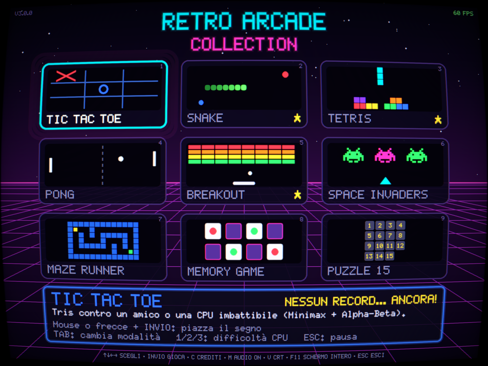
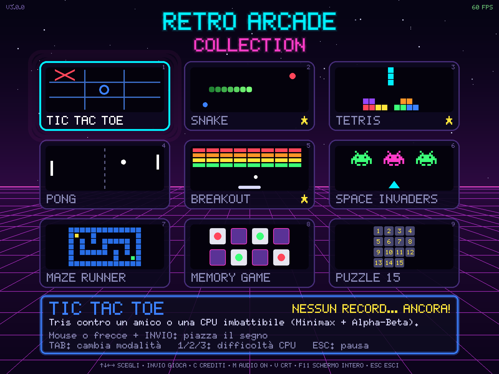
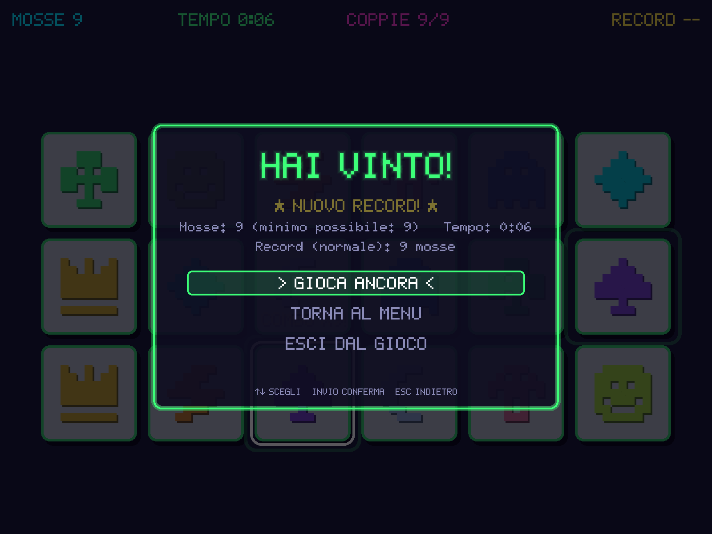
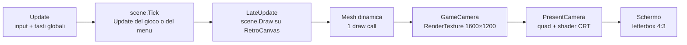

# 🕹️ Retro Arcade Collection — Unity 6

> I nove minigiochi della [versione Python v3](https://github.com/sirAlfry/retro-arcade-collection) (pygame-ce), portati in **Unity 6 + C#**:
> stesso launcher synthwave, stesse regole, stessi comandi, stesso `scores.json`… più un vero monitor CRT fatto con uno shader.

<p align="center">
  
</p>


---

## Indice

1. [Highlights](#-highlights)
2. [Screenshot](#️-screenshot)
3. [Giochi inclusi](#-giochi-inclusi)
4. [Avvio rapido](#-avvio-rapido)
5. [Controlli](#-controlli)
6. [Record e impostazioni](#-record-e-impostazioni)
7. [**Creare l'eseguibile**](#-creare-leseguibile)
8. [Build per il Web e GitHub Pages](#-build-per-il-web-e-github-pages)
9. [Architettura](#️-architettura)
10. [Test e strumenti](#-test-e-strumenti)
11. [Aggiungere un decimo gioco](#-aggiungere-un-decimo-gioco)
12. [Storia del progetto](#-storia-del-progetto)
13. [Idee per andare oltre](#-idee-per-andare-oltre)
14. [Dove approfondire](#-dove-approfondire)

---

## ✨ Highlights

- 🎮 **9 giochi classici** in un unico launcher: griglia prospettica animata, stelle, glow al neon, miniature animate.
- 🐍➡️🔷 **Fedele alla versione Python v3**: stesse regole, stessi menu di pausa e di fine partita, stesse scorciatoie,
  stessi colori e layout (confrontati fianco a fianco, screenshot contro screenshot).
- 🔤 **Font bitmap 5×7 fatto a mano** (lo stesso della versione Python), nitido a ogni scala, con glow e ombra.
- 🔊 **Audio chiptune sintetizzato al volo**: gli stessi ~37 effetti (onde quadre, triangolari, rumore) calcolati in codice
  con `AudioClip.Create`. Nessun file audio.
- 📺 **Monitor CRT vero**: shader con curvatura a botte, scanline, vignetta, aberrazione cromatica e bagliore.
  `V` lo accende/spegne come in Python; `F1` prova le varianti *Off / Soft / Full*. Il mouse viene "ri-curvato" con la
  stessa formula, quindi clicchi esattamente dove vedi.
- 🧠 **Logica separata e testata**: Minimax + Alpha-Beta, Tetris (SRS, 7-bag, lock delay), Snake, labirinti DFS/BFS,
  Memory, Puzzle 15, fisica di Pong/Breakout e Space Invaders stanno in un assembly **senza riferimenti a Unity**:
  **110 test NUnit** che girano sia nel Test Runner sia con `dotnet test`.
- 💾 **Record compatibili con Python**: stesso formato e stesse chiavi di `scores.json`, scrittura atomica, file danneggiato
  messo da parte senza bloccare il gioco.
- 🖥️ **Finestra scalabile 4:3**, schermo intero con `F11`/`Alt+Invio`, **screenshot** con `F12`.
- 📦 **Eseguibile con un clic**: *Tools ▸ Retro Arcade ▸ Crea eseguibile Windows* crea la build **e** lo `.zip` da condividere.
- 🧰 **Strumenti fuori da Unity**: un renderer software che genera gli screenshot di tutte le scene senza aprire l'editor,
  "fuzz test" con input casuale, workflow CI per test e pubblicazione Web.

## 🖼️ Screenshot

<p align="center"></p>

| Launcher | Menu di pausa | Fine partita |
|---|---|---|
|  |  |  |

<sub>Le immagini senza effetto CRT sono generate dal `PreviewRenderer` (vedi [Test e strumenti](#-test-e-strumenti)).
Quella in cima applica la stessa formula dello shader `RetroCRT` a uno di questi screenshot.</sub>

## 🎮 Giochi inclusi

| # | Gioco | Caratteristiche principali |
|---|-------|----------------------------|
| 1 | **Tic Tac Toe** | VS CPU (Facile / Medio / Impossibile) o 2 giocatori, chi inizia si alterna, segni al neon animati, linea vincente animata |
| 2 | **Snake** | Input bufferizzato (curve rapide), frutto bonus a tempo con barra, particelle, velocità crescente |
| 3 | **Tetris** | Rotazione **SRS** con wall kick, **7-bag**, lock delay, hold, ghost piece, 3 pezzi in anteprima, auto-shift (DAS/ARR) |
| 4 | **Pong** | CPU che **prevede i rimbalzi** con 3 livelli, palla che accelera, angolo di rimbalzo controllabile, countdown al servizio |
| 5 | **Breakout** | 5 livelli (poi ciclici e più veloci), mattoni da 1-3 colpi, collisioni sub-step, power-up: paddle largo, multi-palla, rallentatore, vita |
| 6 | **Space Invaders** | 3 tipi di alieni animati, marcia che accelera col classico basso a 4 note, scudi che si sgretolano, UFO bonus |
| 7 | **Maze Runner** | Labirinti perfetti generati con DFS, 4 difficoltà incluso **"al buio"** con torcia, suggerimento **BFS** (+10 s) |
| 8 | **Memory Game** | 3 griglie (4×3, 6×3, 6×4), 12 icone pixel-art, vero flip della carta, combo, giocabile anche da tastiera |
| 9 | **Puzzle 15** | Sempre risolvibile (test di parità corretto), scorrimento di intere file con un clic, tessere al posto giusto evidenziate |

---

## 🚀 Avvio rapido

### Requisiti

| Cosa | Note |
|---|---|
| **Unity Hub** + **Unity 6000.6.x** | Il progetto è sviluppato con **6000.6.0f1** e usa URP 17.6 e Input System 1.20. Versioni 6.x più recenti vanno bene (Unity aggiorna il progetto da solo); con versioni più vecchie i package potrebbero non risolversi. [Download di Unity Hub](https://unity.com/download) |
| Moduli dell'editor | Per l'eseguibile **Windows** non serve niente: il supporto (Mono) è già incluso nell'editor per Windows. Per Linux, macOS o Web: Unity Hub ▸ *Installs* ▸ ⚙ ▸ *Add modules*. |
| Un IDE C# | Visual Studio 2022/2026 (workload *Sviluppo di giochi con Unity*), oppure VS Code con l'estensione **Unity** di Microsoft, oppure Rider. |
| *(Opzionale)* **.NET SDK 8+** | Solo per gli strumenti in `tools/` (test e screenshot fuori da Unity). [Download](https://dotnet.microsoft.com/download) |

### Aprire il progetto

1. **Unity Hub ▸ Projects ▸ Add ▸ Add project from disk** → scegli la cartella `retro-arcade-collection-unity`
   (quella che contiene `Assets`, `Packages`, `ProjectSettings`). Evita percorsi lunghissimi o dentro OneDrive.
2. **Apri** il progetto. La prima volta ci mette qualche minuto (scarica i package e crea la cartella `Library`).
3. Se compare *"Enable the new input system backends?"* rispondi **Yes** (l'editor si riavvia). Il gioco funziona comunque
   anche con il vecchio Input Manager.
4. Lo script di setup attiva URP, crea la scena `RetroArcade`, la apre e la mette nelle Build Settings ("Progetto pronto").
5. Premi ▶ **Play**. Nell'editor `ESC` nel launcher ferma il Play mode, come "Esci" nella versione Python.

Nel menu **Tools ▸ Retro Arcade** trovi anche: *Apri la scena principale*, *Ricrea scena e Build Settings*, *Attiva URP*,
*Azzera i record salvati* e i comandi per [creare l'eseguibile](#-creare-leseguibile).

> 💡 Avvio automatico: se premi Play in *qualsiasi* scena senza un `ArcadeApp`, ne viene creato uno al volo
> (per disattivarlo aggiungi `RETRO_ARCADE_NO_AUTOBOOT` in *Project Settings ▸ Player ▸ Scripting Define Symbols*).

### Le opzioni nell'Inspector

Seleziona il GameObject **RetroArcade** nella scena:

| Campo | Default | A cosa serve |
|---|---|---|
| `Render Scale` | 2 | Risoluzione interna 800×600 × N. Con 2 i cerchi sono più morbidi e il testo piccolo resta nitido. |
| `Crt On Mode` | Full | Che effetto usare quando il filtro CRT è acceso (`V`). `F1` lo cambia al volo. |
| `Start Scene` | LauncherScene | Scrivi `TetrisScene` per partire direttamente da un gioco mentre lo modifichi. |
| `Show Fps` | ✓ | Contatore FPS nel launcher (`F3`). |
| `Random Seed` | 0 | 0 = partite casuali; un numero fisso rende tutto riproducibile, utile per il debug. |

### Se qualcosa non va

| Sintomo | Causa probabile e rimedio |
|---|---|
| Schermo nero o rosa/magenta | Gli shader non sono stati trovati: verifica che esista `Assets/RetroArcade/Resources/RetroArcade/` con i due `.shader` e guarda la Console. |
| Nessun tasto risponde | *Project Settings ▸ Player ▸ Active Input Handling* punta a un sistema non installato: scegli **Input System Package** o **Both**. |
| Hai modificato uno script ma non cambia niente | Unity ricompila quando la sua finestra torna in primo piano: cliccaci sopra e attendi la rotellina in basso a destra. |
| I test non compaiono nel Test Runner | Manca il package **Test Framework** (incluso nei template di Unity 6). |
| La scena non c'è | *Tools ▸ Retro Arcade ▸ Ricrea scena e Build Settings*. |
| Errori del Package Manager all'apertura | Stai usando una versione di Unity più vecchia di quella del progetto: installa la 6000.6 da Unity Hub. |

---

## 🎯 Controlli

Identici alla versione Python. Le uniche aggiunte sono `F1`, `F2` e `F3`, comode per provare gli effetti.

### Launcher

| Tasto | Azione |
|-------|--------|
| ⬆️ ⬇️ ⬅️ ➡️ / WASD / mouse | Scegli il gioco |
| `Invio` / `Spazio` / clic | Avvia il gioco selezionato |
| `1` … `9` | Avvia direttamente il gioco numero N |
| `C` | Crediti |
| `M` | Audio on/off |
| `V` | Filtro CRT on/off |
| `ESC` / `Q` | Esci (nell'editor ferma il Play mode; nel browser non fa nulla) |

### Ovunque

| Tasto | Azione |
|-------|--------|
| `F11` (o `Alt+Invio`) | Schermo intero on/off |
| `F12` | Screenshot nella cartella `screenshots/` (accanto a `scores.json`) |
| `ESC` / `P` (in gioco) | Menu di pausa: Riprendi · Ricomincia · Audio · Filtro CRT · Torna al menu · Esci (scorciatoie `R` `M` `Q`) |
| `F1` *(extra Unity)* | Variante del CRT: Off → Soft → Full |
| `F2` *(extra Unity)* | Audio on/off |
| `F3` *(extra Unity)* | Contatore FPS |

### Controlli di ogni gioco

| Gioco | Controlli |
|-------|-----------|
| Tic Tac Toe | Clic o frecce + `Invio` · `TAB` VS CPU / 2 giocatori · `1` `2` `3` difficoltà CPU · `R` nuova partita |
| Snake | Frecce o WASD |
| Tetris | `←` `→` muovi · `↓` soft drop · `Spazio` hard drop · `↑`/`X` ruota · `Z` ruota indietro · `C`/`Shift` hold |
| Pong | Giocatore 1: `W` `S` (in 1P anche le frecce) · Giocatore 2: `↑` `↓` |
| Breakout | Mouse o frecce / `A` `D` · `Spazio` o clic per lanciare la palla |
| Space Invaders | Frecce o `A` `D` · `Spazio` spara |
| Maze Runner | Frecce o WASD (tieni premuto per correre) · `H` suggerimento |
| Memory Game | Clic, oppure frecce + `Invio` |
| Puzzle 15 | Clic su una tessera nella riga/colonna del buco · frecce · `R` rimescola |

---

## 💾 Record e impostazioni

Record (punteggi, tempi migliori, mosse minime, vittorie a Tris e a Pong) e impostazioni (audio, filtro CRT, ultimo gioco
scelto) finiscono in **`scores.json`**, con **lo stesso formato e le stesse chiavi della versione Python**: puoi copiare
il file da una versione all'altra e ritrovare i tuoi record.

Dove si trova, nell'ordine:

1. dove indica la variabile d'ambiente `RETRO_ARCADE_SCORES`, se c'è;
2. **nell'editor**: nella cartella del progetto (è già nel `.gitignore`);
3. **nell'eseguibile Windows/Linux**: accanto all'eseguibile, se la cartella è scrivibile;
4. altrimenti (cartella protetta come `C:\Program Files`, oppure l'app per macOS) nella cartella dati di Unity
   ([`Application.persistentDataPath`](https://docs.unity3d.com/ScriptReference/Application-persistentDataPath.html)):
   - Windows: `%USERPROFILE%\AppData\LocalLow\Sir Alfry\Retro Arcade Collection\`
   - macOS: `~/Library/Application Support/Sir Alfry/Retro Arcade Collection/`
   - Linux: `~/.config/unity3d/Sir Alfry/Retro Arcade Collection/`
5. **nel browser** (build Web) i dati vanno nei `PlayerPrefs`, che Unity salva in IndexedDB.

Per azzerare i record: cancella il file, oppure *Tools ▸ Retro Arcade ▸ Azzera i record salvati* nell'editor.
Se il file risulta danneggiato viene rinominato in `scores.json.corrupt` e il gioco riparte da zero senza bloccarsi.
Gli screenshot di `F12` vanno nella cartella `screenshots/` accanto a `scores.json`.

---

## 📦 Creare l'eseguibile

È l'equivalente della ricetta PyInstaller della versione Python, ma con un vantaggio: **non serve la riga di comando**.

### Windows, in tre clic

1. Apri il progetto in Unity e assicurati che il Play mode sia **fermo**.
2. Menu **Tools ▸ Retro Arcade ▸ Crea eseguibile Windows**.
3. Aspetta la fine (la prima volta 1-3 minuti, poi molto meno): si apre la cartella con il risultato.

Lo script ([`RetroArcadeBuild.cs`](Assets/RetroArcade/Editor/RetroArcadeBuild.cs)) fa tutto da solo:

- imposta nome (*Retro Arcade Collection*), autore, versione (`3.0.0`), **icona** pixel-art e finestra
  **ridimensionabile 800×600** con schermo intero consentito (`F11` / `Alt+Invio`), **senza** lo splash "Made with Unity";
- controlla che la scena sia nelle Build Settings e che il modulo della piattaforma sia installato;
- compila in una cartella pulita e toglie le cartelle di debug che non vanno distribuite;
- crea lo **`.zip` pronto da condividere**;
- se avevi già giocato con la build precedente, **conserva** il tuo `scores.json` e i tuoi screenshot (che non finiscono nello zip).

Il risultato:

```
Builds/
├── RetroArcadeCollection-Windows-v3.0.0.zip   ← questo è il file da condividere
└── Windows/
    ├── RetroArcadeCollection.exe              ← doppio clic per giocare
    ├── RetroArcadeCollection_Data/            ← scene, shader, codice compilato (indispensabile!)
    ├── MonoBleedingEdge/                      ← il runtime .NET di Unity (indispensabile!)
    └── UnityPlayer.dll, UnityCrashHandler64.exe
```

> ⚠️ **L'`.exe` da solo non basta.** A differenza di PyInstaller (che crea un file unico), Unity crea una *cartella*:
> l'eseguibile cerca accanto a sé `RetroArcadeCollection_Data`, `MonoBleedingEdge` e `UnityPlayer.dll`.
> Per spostarlo o condividerlo usa lo **zip** (o copia l'intera cartella `Windows`). Chi lo riceve: *Estrai tutto* →
> doppio clic su `RetroArcadeCollection.exe`. Non serve installare Unity né .NET.

### Da sapere

- **Avviso di Windows SmartScreen** ("Windows ha protetto il PC"): capita con tutti gli eseguibili non firmati
  digitalmente. *Ulteriori informazioni* → *Esegui comunque*. Per farlo sparire servirebbe un certificato di
  [firma del codice](https://learn.microsoft.com/windows/win32/seccrypto/cryptography-tools).
- **La cartella `Builds/`** è esclusa dal `.gitignore`: per pubblicare lo zip usa le
  [Release di GitHub](https://docs.github.com/repositories/releasing-projects-on-github/managing-releases-in-a-repository).
- **Il log** dell'eseguibile (utile se qualcosa va storto) è in
  `%USERPROFILE%\AppData\LocalLow\Sir Alfry\Retro Arcade Collection\Player.log`
  ([dove sono i log di Unity](https://docs.unity3d.com/Manual/LogFiles.html)).
- **Versione**: si cambia in `ArcadeInfo.Version` (`Assets/RetroArcade/Runtime/Core/ArcadeInfo.cs`); è la stessa
  mostrata nel launcher e nel nome dello zip.
- **Solo le impostazioni**: *Tools ▸ Retro Arcade ▸ Applica solo le impostazioni del Player* applica nome, icona e
  finestra senza compilare (utile se vuoi usare la finestra standard di Unity, vedi sotto).

### Linux e macOS

Unity, a differenza di PyInstaller, **sa compilare per altri sistemi** dallo stesso PC, basta aggiungere il modulo
(Unity Hub ▸ *Installs* ▸ ⚙ ▸ *Add modules* ▸ *Linux Build Support (Mono)* o *Mac Build Support (Mono)*):

- **Tools ▸ Retro Arcade ▸ Crea eseguibile Linux** → `Builds/Linux/RetroArcadeCollection.x86_64` + zip.
  Su Linux, dopo aver estratto: `chmod +x RetroArcadeCollection.x86_64` (lo zip creato su Windows non conserva i permessi).
- **Tools ▸ Retro Arcade ▸ Crea app macOS** → `Builds/macOS/RetroArcadeCollection.app` + zip. L'app non è firmata:
  sul Mac la prima volta va aperta con *clic destro ▸ Apri*; se macOS dice che è "danneggiata", da Terminale
  `xattr -cr RetroArcadeCollection.app`. Per distribuirla seriamente serve la
  [firma e notarizzazione Apple](https://docs.unity3d.com/Manual/macos-building-notarization.html).

### In alternativa: la finestra standard di Unity

*File ▸ Build Profiles* → scegli la piattaforma → (*Switch Platform* se serve) → **Build**. La scena è già in lista.
Ti chiede una cartella: creane una vuota apposta (Unity ci mette diversi file). Prima lancia
*Applica solo le impostazioni del Player* per avere nome, icona e finestra giusti.
([manuale: Build Profiles](https://docs.unity3d.com/Manual/build-profiles.html))

### Da riga di comando (CI, script)

```powershell
& "C:\Program Files\Unity\Hub\Editor\6000.6.0f1\Editor\Unity.exe" -batchmode -quit -projectPath . `
  -executeMethod RetroArcade.EditorTools.RetroArcadeBuild.BuildWindowsCli -logFile build.log
```

Esce con codice 0 se la build riesce, 1 se fallisce (`BuildLinuxCli` e `BuildMacCli` per le altre piattaforme).
Il progetto non deve essere aperto in un altro editor nello stesso momento.
([argomenti della riga di comando](https://docs.unity3d.com/Manual/EditorCommandLineArguments.html))

### Se qualcosa va storto

| Problema | Soluzione |
|---|---|
| *Manca il modulo "… Build Support"* | Unity Hub ▸ *Installs* ▸ ⚙ accanto alla tua versione ▸ *Add modules*, poi riapri il progetto. |
| *Build non riuscita* | Apri la Console (*Window ▸ General ▸ Console*): il primo errore rosso è quello che conta. Spesso è un errore di compilazione in uno script modificato. |
| L'eseguibile si apre e si chiude subito | Leggi `Player.log` (percorso sopra). Se hai spostato solo l'`.exe`, rimetti accanto le altre cartelle. |
| L'antivirus mette l'eseguibile in quarantena | Falso positivo tipico dei programmi non firmati: aggiungi un'eccezione o segnalalo al produttore dell'antivirus. |
| La finestra si apre a una misura strana | Unity ricorda l'ultima finestra nel registro (`HKCU\Software\Sir Alfry\Retro Arcade Collection`): cancella quella chiave, oppure avvia con `-screen-width 1200 -screen-height 900`. |

---

## 🌐 Build per il Web e GitHub Pages

1. *File ▸ Build Profiles ▸ Web ▸ Switch Platform* (serve il modulo *Web Build Support*).
2. *Project Settings ▸ Player ▸ Web ▸ Publishing Settings ▸ Compression Format*:
   - **Disabled** se pubblichi su GitHub Pages (che non invia l'header `Content-Encoding` per i file `.gz`/`.br`);
   - oppure lascia *Gzip* e attiva **Decompression Fallback** (decomprime in JavaScript, caricamento un po' più lento).
3. **Build** in una cartella, per esempio `Builds/Web`. Per provarla in locale: `python -m http.server 3000` dentro quella
   cartella (`file://` non funziona).

Nel browser i record vanno nei `PlayerPrefs`, `F12` e "Esci" non sono disponibili.

**Pubblicazione automatica** con il workflow [`.github/workflows/ci.yml`](.github/workflows/ci.yml): il job `logic` gira
a ogni push (test + fuzz + screenshot, senza licenze); i job `web` e `deploy` partono con *Actions ▸ CI ▸ Run workflow*
e usano [GameCI](https://game.ci/docs/github/activation). Servono i secrets `UNITY_LICENSE` (contenuto del file `.ulf`
della licenza Personal), `UNITY_EMAIL`, `UNITY_PASSWORD` e *Settings ▸ Pages ▸ Source: GitHub Actions*.

---

## 🏗️ Architettura

```
Assets/RetroArcade/
├── Logic/                        ← assembly RetroArcade.Logic: C# puro, ZERO riferimenti a Unity (testabile ovunque)
│   ├── GameAI.cs                   Random / Heuristic / Minimax / Alpha-Beta (porting di game_ai.py)
│   ├── TicTacToeState.cs           le regole del Tris per l'AI
│   ├── SnakeLogic.cs  TetrisLogic.cs  MazeLogic.cs  MemoryLogic.cs  Puzzle15Logic.cs
│   ├── PRect.cs                    pygame.Rect in C# + la fisica di Pong/Breakout (ArcadePhysics)
│   ├── BreakoutLevels.cs  InvadersArt.cs   livelli, sprite e scudi
│   └── Int2.cs                     le tuple (x, y) di Python
├── Runtime/                      ← assembly RetroArcade.Runtime
│   ├── Core/
│   │   ├── ArcadeApp.cs            l'unico MonoBehaviour: crea tutto, tasti globali, dissolvenze, screenshot
│   │   ├── ArcadeScene.cs          base dei giochi + menu di pausa / fine partita / scelta (come game_shared)
│   │   ├── MenuOverlay.cs          il menu neon tastiera + mouse (_run_menu) e i pannelli
│   │   ├── RetroCanvas.cs          renderer immediate-mode (rettangoli, cerchi, linee "alla pygame", clip)
│   │   ├── PixelFont5x7.cs         il font 5×7 della versione Python
│   │   ├── Effects.cs              particelle, testi fluttuanti, screen shake, cronometro
│   │   ├── Sfx.cs                  sintetizzatore chiptune (porting di sfx.py)
│   │   ├── ScoreStore.cs           scores.json atomico, PlayerPrefs sul Web (porting di scores.py)
│   │   ├── ArcadeInput.cs          tastiera/mouse, nuovo Input System o legacy, auto-repeat
│   │   ├── CrtPresenter.cs         RenderTexture → quad con shader CRT, letterbox 4:3
│   │   └── Palette.cs  IArcadeHost.cs  SceneKeys.cs  ArcadeInfo.cs …
│   └── Games/                      LauncherScene, GameCatalog, Thumbs + i 9 giochi (uno per file)
├── Resources/RetroArcade/        ← RetroVector.shader, RetroCRT.shader (sempre inclusi nelle build)
├── Editor/
│   ├── RetroArcadeSetup.cs         primo avvio: URP, scena, Build Settings; menu Tools ▸ Retro Arcade
│   └── RetroArcadeBuild.cs         "Crea eseguibile": impostazioni del Player, build, zip
├── Art/icon.png                  ← l'icona dell'eseguibile
└── Tests/EditMode/               ← 110 test NUnit sulla logica
tools/                            ← LogicTests (dotnet test) e PreviewRenderer (screenshot/fuzz senza Unity)
```

### Da pygame a Unity: la "stele di Rosetta"

| Python + pygame-ce | Questo progetto (C#) |
|---|---|
| `retro_arcade_interface.py` (tupla `GAMES`) | `GameCatalog.Games` — da lì derivano tessere, pannello info e record |
| `def main(...) -> "menu" \| "quit"` con il suo `while True` | `class X : ArcadeScene` con `Create()` / `Update(timeMs, deltaMs)` / `Draw(g)`: il ciclo lo fa `ArcadeApp` |
| `pygame.draw.rect(screen, color, rect, width, border_radius)` | `g.FillRoundedRect(...)` / `g.StrokeRoundedRect(...)` dentro `Draw(RetroCanvas g)` |
| `pygame.draw.line(..., width)` | `g.Line(...)` — stessa geometria delle linee spesse di pygame |
| `screen.set_clip(rect)` | `g.PushClip(...)` / `g.PopClip()` |
| `blit_pixel_text(screen, text, pos, scale, color, "center")` | `g.PixelText(text, x, y, scale, color, 0.5f, 0.5f)` |
| `pygame.Rect` | `PRect` (stessa aritmetica intera, stesso `colliderect`) |
| `gs.in_game_menu(...)`, `gs.end_screen(...)` | `OpenPauseMenu(...)`, `OpenEndScreen(...)` |
| eventi `KEYDOWN` / `pygame.key.get_pressed()` | `In.Pressed(ArcadeKey.Left)` / `In.Held(...)` · auto-repeat: `In.Repeat(...)` |
| `MOUSEBUTTONDOWN` + `e.pos` | `In.PointerPressed` + `In.Pointer` (già in coordinate 800×600) |
| `sfx.play("score")` | `Sfx.Play(SfxId.Score)` |
| `scores.record_best(...)` | `ScoreStore.RecordBest(key, value, lowerIsBetter)` |
| `random.uniform(a, b)`, `random.randint(a, b)` | `Uniform(a, b)`, `RandInt(a, b)` (stessa semantica, estremi inclusi) |
| `pygame.SCALED` + filtro CRT in software | `CrtPresenter`: RenderTexture 1600×1200 + shader sulla GPU |

### Il viaggio di un frame



### Perché "immediate mode" invece di GameObject e Sprite?

Perché è il modo più fedele di portare un progetto che **non ha asset** e disegna tutto con le primitive: il codice di
ogni gioco resta vicinissimo a quello Python (spesso riga per riga) e il confronto fra le due versioni diventa didattico.
In più ogni frame è **una sola draw call** e non c'è nulla da trascinare nell'Inspector.

Il rovescio della medaglia: non si usano Physics 2D, Animator, Tilemap, UI Toolkit… L'architettura però non lo impedisce:
una scena può creare GameObject nel `Create()` e distruggerli nello `Shutdown()`.

### Dettagli che fanno la differenza

- **Color space**: i template Unity 6 sono in *Linear*. I colori `(r, g, b)` di Python sono sRGB, quindi `RetroCanvas` li converte, altrimenti uscirebbero slavati.
- **Pixel perfect**: il testo viene "agganciato" alla griglia della RenderTexture; con `Render Scale = 2` anche le scale 1.5 hanno pixel tutti uguali.
- **Shader compatibili con tutte le pipeline**: CG senza `LightMode`, quindi funzionano in Built-in e in URP. Stanno in `Resources/` per essere sempre inclusi nelle build.
- **Asmdef**: `Logic` ha `noEngineReferences: true`, quindi è impossibile infilarci per sbaglio una dipendenza da Unity.

---

## ✅ Test e strumenti

**In Unity** — *Window ▸ General ▸ Test Runner ▸ EditMode ▸ Run All*: 110 test, tra cui

- la CPU "Impossibile" del Tris **non perde mai**, contro *tutte* le possibili sequenze di mosse dell'avversario;
- Tetris: rotazioni SRS e wall kick, 7-bag, lock delay, hard drop, punteggi per livello, hold, gravità, game over;
- Snake: buffer delle curve, niente inversioni a U, può inseguire la propria coda, velocità che cresce col punteggio;
- ogni labirinto è "perfetto" (un solo percorso fra due celle) e il BFS trova sempre l'uscita;
- ogni mescolata del 15 è risolvibile e non già risolta; le mosse di più tessere e le frecce;
- la previsione dei rimbalzi della CPU di Pong, i livelli di Breakout, gli scudi di Space Invaders, le griglie del Memory.

**Fuori da Unity** (serve il [.NET SDK](https://dotnet.microsoft.com/download)):

```bash
dotnet test tools/LogicTests                                               # gli stessi 110 test, in ~1 secondo
dotnet run --project tools/PreviewRenderer -c Release -- screenshots       # 23 screenshot di tutte le scene
dotnet run --project tools/PreviewRenderer -c Release -- --fuzz 120        # input casuale: cerca eccezioni
```

Il `PreviewRenderer` esegue le **vere** scene con un mini-`UnityEngine` in puro C# e un rasterizzatore software: gli
screenshot di questo README sono stati generati così. Dettagli in [`tools/README.md`](tools/README.md).

---

## ➕ Aggiungere un decimo gioco

Esempio: un "Asteroids".

1. Crea `Assets/RetroArcade/Runtime/Games/AsteroidsScene.cs`:

   ```csharp
   namespace RetroArcade.Games
   {
       public sealed class AsteroidsScene : ArcadeScene
       {
           private static readonly string[] Commands = { "Frecce: ruota e spingi", "SPAZIO: spara" };
           private float _x = W / 2, _y = H / 2;
           private int _score;

           public override void Update(float timeMs, float deltaMs)
           {
               float dt = deltaMs / 1000f;                                  // secondi, come il dt di Python
               if (PausePressed()) { OpenPauseMenu("Asteroids", Commands); return; }
               if (In.Held(ArcadeKey.Left)) _x -= 240 * dt;
               if (In.Held(ArcadeKey.Right)) _x += 240 * dt;
               if (In.Pressed(ArcadeKey.Space)) { _score += 10; Sfx.Play(SfxId.Shoot); }
           }

           public override void Draw(RetroCanvas g)
           {
               g.FillRect(0, 0, W, H, Palette.Bg);
               g.FillTriangle(_x, _y - 14, _x - 10, _y + 10, _x + 10, _y + 10, Palette.NeonCyan);
               g.PixelText("PUNTI " + _score, 14, 22, 2, Palette.NeonYellow, 0f, 0.5f);
           }
       }
   }
   ```

2. Registra la chiave in `SceneKeys.cs` (`public const string Asteroids = "AsteroidsScene";`) e la fabbrica in
   `SceneRegistry.Factories`.
3. Aggiungi una riga in `GameCatalog.Games` (nome, chiave, descrizione, comandi, record, colore) e una miniatura in
   `Thumbs.Draw`. La griglia del launcher è 3×3: con 10 giochi conviene passare a 4 colonne cambiando `Cols`/`TileW`
   in `LauncherScene` (per avviarlo col tasto `0` aggiungi `Zero` all'enum `ArcadeKey`).
4. Lancia `dotnet run --project tools/PreviewRenderer -c Release -- --fuzz 60` per una prima verifica senza aprire Unity.

---

## 📜 Storia del progetto

- **v1 — porting da Phaser 4.** La prima versione Unity nasceva dalla
  [versione Phaser](https://github.com/sirAlfry/retro-arcade-collection-phaser). Durante quel porting sono emersi
  9 bug dell'originale JavaScript (il più grave: il Puzzle 15 generava **solo** scacchiere irrisolvibili per una parità
  invertita), tutti corretti e coperti da test.
- **v3.0 — allineata alla versione Python v3.** Launcher, menu, comandi, record e i 9 giochi sono stati riscritti
  seguendo `retro-arcade-collection` (pygame-ce), confrontando gli screenshot delle due versioni fianco a fianco.
  Da Python arrivano anche il motore AI generico, Tetris con SRS/7-bag, i power-up di Breakout, gli scudi di Space
  Invaders, il labirinto al buio, il formato di `scores.json`. In più: la build con un clic e lo shader CRT.

---

## 🔮 Idee per andare oltre

- **Gamepad**: in `ArcadeInput` aggiungi `Gamepad.current` (dpad → frecce, *South* → Invio/Spazio, *Start* → ESC).
  Con le *Input Actions* del [nuovo Input System](https://docs.unity3d.com/Manual/com.unity.inputsystem.html) ottieni anche il remapping.
- **Release automatiche**: un job GameCI con `targetPlatform: StandaloneWindows64` che a ogni tag pubblica lo zip nelle Release di GitHub.
- **Neon vero**: in URP aggiungi un *Volume* con **Bloom** e usa colori HDR solo per glow e titoli.
- **Classifiche online**: *Unity Gaming Services ▸ Leaderboards*, mantenendo `ScoreStore` come facciata (basta un nuovo `IScoreStorage`).
- **Attract mode**: il bot di Tetris (e quello di Snake) che stanno in `tools/PreviewRenderer` possono far giocare il
  launcher da solo dopo 30 secondi di inattività, come nei cabinati veri.
- **Musica chiptune** generata dallo stesso sintetizzatore di `Sfx.cs`.
- **Mobile**: il tocco funziona già come clic; per Snake/Tetris servono pulsanti a schermo (Input System ▸ *On-Screen Controls*).

---

## 📚 Dove approfondire

| Argomento | Link |
|---|---|
| Unity 6 (rilasci e supporto) | [unity.com/releases/unity-6](https://unity.com/releases/unity-6) |
| Build Profiles e Player Settings | [docs.unity3d.com/Manual/build-profiles.html](https://docs.unity3d.com/Manual/build-profiles.html) |
| Script di build (`BuildPipeline`) | [docs.unity3d.com/ScriptReference/BuildPipeline.BuildPlayer.html](https://docs.unity3d.com/ScriptReference/BuildPipeline.BuildPlayer.html) |
| Assembly definition | [docs.unity3d.com/Manual/assembly-definitions-intro.html](https://docs.unity3d.com/Manual/assembly-definitions-intro.html) |
| Input System | [docs.unity3d.com/Manual/com.unity.inputsystem.html](https://docs.unity3d.com/Manual/com.unity.inputsystem.html) |
| Unity Test Framework | [docs.unity3d.com/Manual/test-framework/test-framework-introduction.html](https://docs.unity3d.com/Manual/test-framework/test-framework-introduction.html) |
| `Mesh` dinamiche via script | [docs.unity3d.com/ScriptReference/Mesh.html](https://docs.unity3d.com/ScriptReference/Mesh.html) |
| ShaderLab e shader HLSL | [docs.unity3d.com/Manual/SL-Reference.html](https://docs.unity3d.com/Manual/SL-Reference.html) |
| GameCI (Unity su GitHub Actions) | [game.ci/docs](https://game.ci/docs/github/getting-started) |
| Corsi gratuiti | [learn.unity.com](https://learn.unity.com) |

Gli algoritmi: [Super Rotation System](https://tetris.wiki/Super_Rotation_System) e [7-bag](https://tetris.wiki/Random_Generator) (Tetris),
[Minimax](https://it.wikipedia.org/wiki/Minimax) e [potatura alfa-beta](https://it.wikipedia.org/wiki/Potatura_alfa-beta) (Tris),
[generazione di labirinti](https://en.wikipedia.org/wiki/Maze_generation_algorithm) e [BFS](https://it.wikipedia.org/wiki/Ricerca_in_ampiezza) (Maze Runner),
[risolvibilità del gioco del 15](https://it.wikipedia.org/wiki/Gioco_del_quindici).

---

## 👤 Autore

**Alfredo De Donno (Sir Alfry)** — [GitHub](https://github.com/sirAlfry) · [ArtStation](https://www.artstation.com/siralfry) · [Instagram](https://www.instagram.com/sir_alfry)

## 📄 Licenza e crediti

Codice sotto licenza **MIT** (vedi [LICENSE](LICENSE)).
Font: il font 5×7 è disegnato a mano (dalla versione Python); per i testi piccoli X11 *misc-fixed 6×10*
("Public domain font. Share and enjoy.") e [*font8x8*](https://github.com/dhepper/font8x8) di Daniel Hepper (pubblico dominio).

<p align="center"><em>Fatto con ☕, C#, Unity 6 e la stessa nostalgia per le sale giochi anni '80.</em></p>
